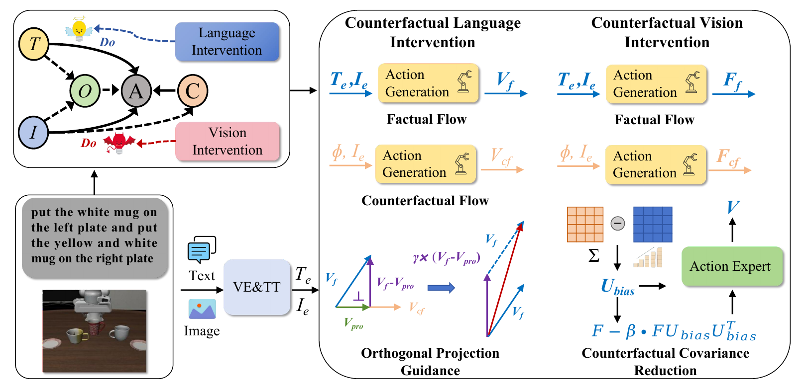
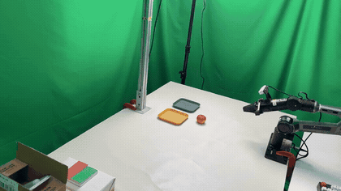
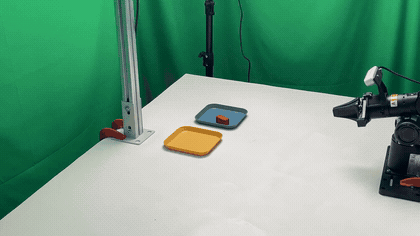
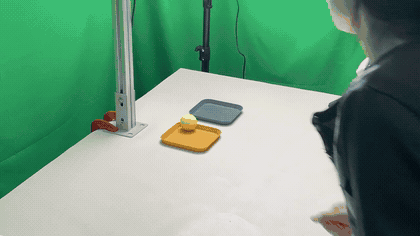
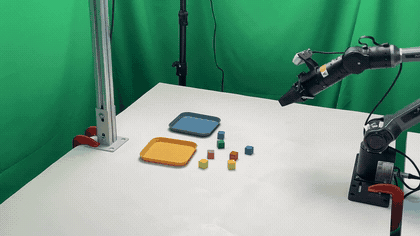
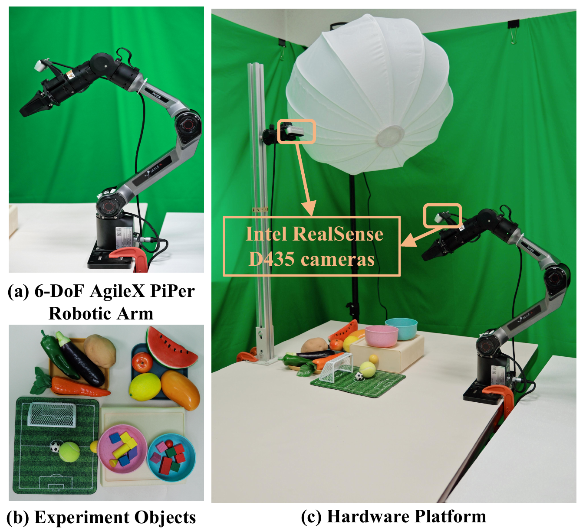

# CofactVLA

**Deconfounding Vision-Language-Action Models via Counterfactual Intervention (NeurIPS 2026)**

Yan Zhang, Yinan Wu, Haoran Duan, Jungong Han

CofactVLA addresses *vision override*: a robot follows familiar visual cues while overlooking the language instruction. Built on π₀.₅ and LeRobot, it pairs a factual forward pass with a text-masked counterfactual branch. **Orthogonal Projection Guidance (OPG)** amplifies the action velocity component orthogonal to the counterfactual prediction. **Counterfactual Covariance Reduction (CCR)** suppresses positive covariance-difference directions in selected VLM key/value features.

In this method, the text input includes both the task instruction and discretized robot state. The counterfactual branch masks this complete text stream while retaining the image inputs. This research snapshot provides π₀.₅ fine-tuning and evaluation on the **four standard LIBERO suites**, plus **AgileX PiPer real-world training and deployment**.




*Overview of CofactVLA (Figure 2 in the paper).*

## Demo videos

Real-world demonstrations on the AgileX PiPer arm. Click an animated preview or an **MP4** link to open the complete video. All clips are muted and retain the playback speed of the source recordings.

<table>
  <tr>
    <td align="center" width="50%">
      <strong>Apple placement</strong><br>
      <a href="docs/videos/apple.mp4"></a><br>
      <em>Put the apple on the yellow plate.</em><br>
      <a href="docs/videos/apple.mp4">MP4</a>
    </td>
    <td align="center" width="50%">
      <strong>Cuboid removal</strong><br>
      <a href="docs/videos/cuboid.mp4"></a><br>
      <em>Remove the cuboid from the blue plate.</em><br>
      <a href="docs/videos/cuboid.mp4">MP4</a>
    </td>
  </tr>
  <tr>
    <td align="center" width="50%">
      <strong>Tennis ball transfer</strong><br>
      <a href="docs/videos/tennis-ball.mp4"></a><br>
      <em>Move the tennis ball from the yellow plate to the blue plate.</em><br>
      <a href="docs/videos/tennis-ball.mp4">MP4</a>
    </td>
    <td align="center" width="50%">
      <strong>Red cube placement</strong><br>
      <a href="docs/videos/red-cube.mp4"></a><br>
      <em>Pick the red cube into the yellow plate.</em><br>
      <a href="docs/videos/red-cube.mp4">MP4</a>
    </td>
  </tr>
</table>

<details>
<summary><strong>Additional scenes and perturbations (8 videos)</strong></summary>

| Task | Scene / perturbation | Video |
|---|---|---|
| Apple placement | Additional distractor objects | [MP4](docs/videos/apple-distractors.mp4) |
| Cuboid removal | Distractor objects on the plate | [MP4](docs/videos/cuboid-on-plate-distractors.mp4) |
| Cuboid removal | Same-color distractors with different shapes | [MP4](docs/videos/cuboid-same-color-distractors.mp4) |
| Cuboid removal | Additional object beside the plate | [MP4](docs/videos/cuboid-surrounding-distractors.mp4) |
| Cuboid removal | Additional trial with surrounding objects | [MP4](docs/videos/cuboid-additional-trial.mp4) |
| Tennis ball transfer | Patterned table covering | [MP4](docs/videos/tennis-ball-background.mp4) |
| Tennis ball transfer | Patterned table covering and changed plate appearance | [MP4](docs/videos/tennis-ball-background-plates.mp4) |
| Red cube placement | Object perturbation | [MP4](docs/videos/red-cube-perturbation.mp4) |

</details>

## Installation and assets

Run training and robot execution on **Linux with NVIDIA GPUs**. From the repository root, install the environment:

```bash
conda create -n cofactvla python=3.12 -y
conda activate cofactvla
conda install -c conda-forge 'ffmpeg=7.*' -y
python -m pip install --upgrade pip
python -m pip install torch==2.10.0 torchvision==0.25.0 \
  --index-url https://download.pytorch.org/whl/cu128
python -m pip install -c constraints-release.txt -e '.[pi,libero]'
python -m pip check
```

For headless LIBERO simulation on Ubuntu:

```bash
sudo apt-get update
sudo apt-get install -y libegl1 libgl1 libosmesa6
export MUJOCO_GL=egl
export PYOPENGL_PLATFORM=egl
```

From this repository root, with the environment activated:

```bash
hf auth login
hf download lerobot/pi05_libero_base --local-dir assets/pi05_libero_base
hf download lerobot/pi05_base --local-dir assets/pi05_base
hf download lerobot/libero --repo-type dataset --local-dir data/libero
```

Accept access terms for the [PaliGemma tokenizer](https://huggingface.co/google/paligemma-3b-pt-224) if required. The downloaded LIBERO dataset must be compatible with this code's LeRobot v3 format and contain `q01` and `q99` quantile statistics for both `observation.state` and `action` in `meta/stats.json`. Set `--dataset-root` to the directory containing `meta/`. Keep the exact asset revisions with your experiment records.

## Paper configuration

| Parameter | Value |
|---|---|
| Training hardware | 4 × NVIDIA H100, 96 GB per GPU (as reported in the paper) |
| Backbone | π₀.₅ |
| Batch size | 32 per GPU; global batch 128 |
| Optimizer | AdamW; LR `2.5e-5`; betas `[0.9, 0.95]`; weight decay `0.01` |
| Training / warm-up steps | 6,000 / 1,000 |
| OPG scale γ / CCR strength β | `2.0` / `0.15` |
| Action chunk size | 50 |
| Freeze vision encoder / action expert | False / False |
| Gradient checkpointing | True |
| Standard LIBERO evaluation | 10 episodes per task, all four suites |
| Real-world evaluation | 100 independent trials per task; 10 Hz command dispatch |

## π₀.₅ training on LIBERO

```bash
CUDA_VISIBLE_DEVICES=0,1,2,3 python scripts/cofact/run.py train-libero \
  --dataset-root data/libero \
  --pretrained assets/pi05_libero_base \
  --output outputs/cofact_libero
```

The launcher uses four distributed processes, batch 32 per process, 6,000 steps and **explicitly sets the scheduler decay horizon to 6,000**. Choose a fresh output directory for each run. Add `--dry-run` to print the full underlying LeRobot command without loading any dependencies or assets.

For a π₀.₅ baseline, repeat with `--method baseline --output outputs/pi05_libero`. This disables OPG and CCR while keeping the training budget and initialization the same. Evaluate the corresponding separately trained checkpoint.

## LIBERO evaluation

```bash
CUDA_VISIBLE_DEVICES=0 python scripts/cofact/run.py eval-libero \
  --checkpoint outputs/cofact_libero/checkpoints/last/pretrained_model \
  --output outputs/eval_cofact_libero
```

This runs `libero_spatial`, `libero_object`, `libero_goal` and `libero_10` (LIBERO-Long), with 10 episodes **per task**, one environment, and 10 executed actions per observation. Use one process for evaluation to avoid accidentally duplicating rollouts. LeRobot writes evaluation metrics and available rollout videos under the output directory. For the baseline, add `--method baseline` and supply its checkpoint.

EGL is the default headless renderer. For a host configured for OSMesa:

```bash
MUJOCO_GL=osmesa PYOPENGL_PLATFORM=osmesa CUDA_VISIBLE_DEVICES=0 \
  python scripts/cofact/run.py eval-libero \
  --checkpoint outputs/cofact_libero/checkpoints/last/pretrained_model \
  --output outputs/eval_cofact_libero_osmesa
```

## Real-world training and testing

<p align="center">
  
</p>

*Real-world robot platform (Figure 8 in the paper).*

The setup uses a 6-DoF AgileX PiPer arm with a parallel gripper and two Intel RealSense D435 cameras (overhead and wrist). Each task uses approximately 100 demonstration trajectories and 100 evaluation trials.

Use LeRobot v3 data with RGB keys `observation.images.cam_high` and `observation.images.cam_wrist`. State and action vectors contain six joint positions in radians followed by the gripper position in `[0,1]`.

Train a task-specific model on your local LeRobot dataset:

```bash
CUDA_VISIBLE_DEVICES=0,1,2,3 python scripts/cofact/run.py train-real \
  --dataset-repo-id local/put_the_apple_on_the_yellow_plate \
  --dataset-root data/put_the_apple_on_the_yellow_plate \
  --pretrained assets/pi05_base \
  --output outputs/cofact_piper_apple
```

Repeat for the other three tasks: remove the cuboid from the blue plate; move the tennis ball from the yellow plate to the blue plate; and pick the red cube into the yellow plate.

For deployment, copy the **complete** `pretrained_model` directory, including processors and normalization statistics, to the Linux robot host.

## Code map

| Location | Purpose |
|---|---|
| `src/lerobot/policies/pi05/opg.py` | OPG: `apply_opg`, used by training and inference |
| `src/lerobot/policies/pi05/ccr.py` | CCR: `apply_ccr`, used by inference KV intervention |
| `src/lerobot/policies/pi05/modeling_pi05.py` | Paired branches, training loss, inference and KV intervention |
| `src/lerobot/policies/pi05/configuration_pi05.py` | OPG/CCR parameters and validation |
| `src/lerobot/configs/pi05_compat.py` | Legacy PI05 configuration and CLI name translation |
| `scripts/cofact/run.py` | Paper-parameter training and LIBERO evaluation |
| `deploy_piper.py`, `src/lerobot/robots/piper/` | PiPer deployment and hardware adapter |
| `tests/cofact/` | Focused CPU checks |

## Citation and acknowledgements

```bibtex
@article{zhang2026cofactvla,
  title={CofactVLA: Deconfounding Vision-Language-Action Models via Counterfactual Intervention},
  author={Zhang, Yan and Wu, Yinan and Duan, Haoran and Han, Jungong},
  journal={arXiv preprint arXiv:2608.04396},
  year={2026}
}
```

This code builds on [LeRobot](https://github.com/huggingface/lerobot), [OpenPI](https://github.com/Physical-Intelligence/openpi), [LIBERO](https://github.com/Lifelong-Robot-Learning/LIBERO), and the [PiPer SDK](https://github.com/agilexrobotics/piper_sdk). 
Existing license and copyright notices are retained; see [LICENSE](LICENSE). Dataset and checkpoint access remain subject to the terms of their respective providers.
